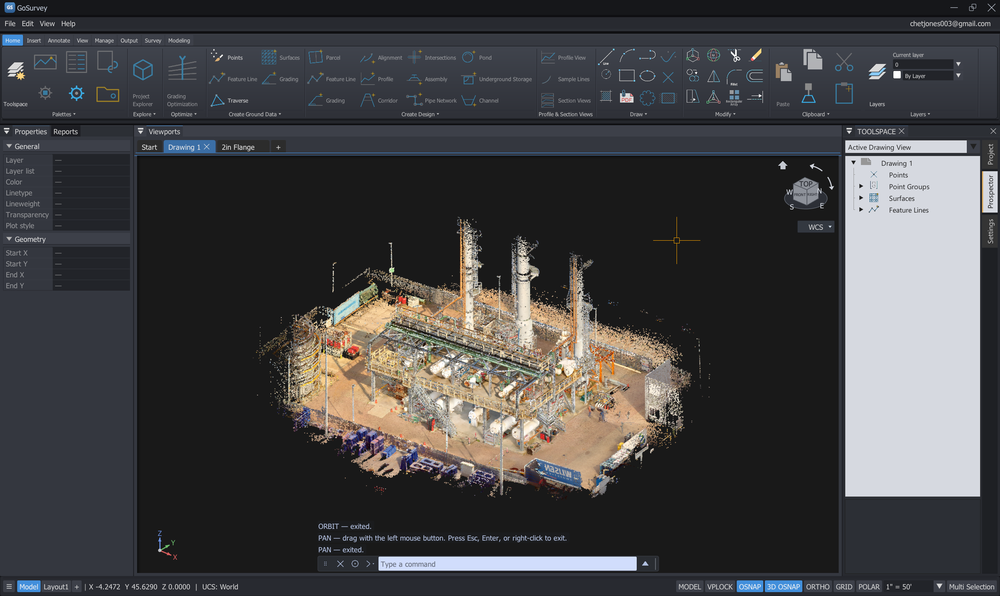

# GoSurvey

**Survey drafting and COGO for Windows.**

GoSurvey is a fast, modern CAD platform built for land surveyors. Draw linework in bearings and distances, manage a survey-point database, reduce raw field observations, build TIN surfaces, align local coordinates to state plane, and plot turnover sheets — with exchange to AutoCAD and Civil 3D through DXF, DWG, and CSV.

---

## Download

**[gosurveycad.com](https://gosurveycad.com)**

GoSurvey is free to install. After setup it checks for updates on startup and asks before downloading anything. Stable and beta channels are available in *Settings → System → Updates*.

---

## Documentation

Step-by-step guides, command reference, workflows, and troubleshooting live at **[gosurveycad.com/docs/](https://gosurveycad.com/docs/)**.

Inside the app, press **F1** or type **`HELP`** to open the same manual.

---

## License

GoSurvey is licensed under **GPL-3.0-or-later** (LibreDWG linkage). See [`installer/License.txt`](installer/License.txt) for full text and third-party notices.

---

## For developers

GoSurvey is built with CMake, MSVC, and Ninja on Windows. See [`dev/README.md`](dev/README.md) for the full build adapter reference (`./dev/build`, `./dev/run`, `./dev/test`, etc.).

### Project workflow

This repo follows a three-layer governance model — **SPEC → VERIFICATION → WORKSHOP** — defined in full in [`CLAUDE.md`](CLAUDE.md):

1. **Understand** — identify the applicable requirement (`REQ-NNN`), constraints (`CON-NN`), and Acceptance Criteria in `spec/`.
2. **Plan** — write or update a task in `workshop/tasks/` before writing code.
3. **Verify the plan** — check it against the spec, architecture, and risks.
4. **Resolve uncertainty** — ambiguous or missing requirements are raised as a **SPEC GAP** and resolved before implementation, never guessed at.
5. **Implement** — the smallest correct change, following `spec/architecture.md` and `spec/coding-standards.md`.
6. **Verify** — build, architecture review, code review, dependency audit, performance review, and tests.
7. **Complete** — a task is only done once its tests, verification result, and documentation updates are recorded.

`spec/` is the single source of truth; implementation never redefines a requirement to make itself pass.

### Branch rules

- `master` — latest stable release. Always clean and release-ready.
- `beta` — current development branch.
- Never commit directly to `master` or `beta`. Work happens on branches cut from `beta`:
  - `feat/<name>`, `fix/<name>`, `docs/<name>`, `refactor/<name>`, `test/<name>`, `chore/<name>`
- Branches merge into `beta` via PR; `beta` merges into `master` via a release PR. Development branches never merge directly into `master`.
- After a branch merges into `beta`, it's deleted (remote, local, and worktree). Only `master` and `beta` persist long-term.

### AI contribution rules

AI-assisted changes (including Claude Code) in this repository follow the same governance as any other contribution:

- All work is scoped to an approved `REQ-NNN` and Acceptance Criteria in `spec/` — no invented requirements, and no editing the spec just to make an implementation pass.
- Ambiguous, contradictory, or architecturally significant decisions are raised as a **SPEC GAP** for a human to resolve, never guessed.
- Changes follow the same Understand → Plan → Verify → Implement → Verify → Complete workflow and branch/PR rules as human contributions.
- Commits and PRs produced with AI assistance carry `Co-Authored-By` attribution identifying the model used.

**[Report an issue](https://github.com/chetjones003/GoSurvey/issues)** · **[All releases](https://github.com/chetjones003/GoSurvey/releases)**
