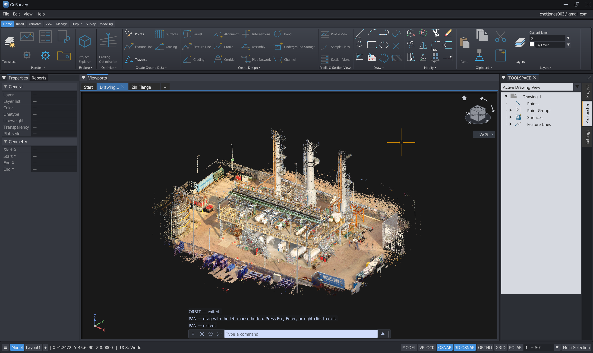

# GoSurvey

**Survey drafting and COGO for Windows.**

GoSurvey is a fast, modern CAD platform built for land surveyors. Draw linework in bearings and distances, manage a survey-point database, reduce raw field observations, build TIN surfaces, define road and utility alignments with stationing, align local coordinates to state plane, and plot turnover sheets — with exchange to AutoCAD and Civil 3D through DXF, DWG, and CSV.



---

## Download

**[gosurveycad.com](https://gosurveycad.com)**

GoSurvey is free to install. After setup it checks for updates on startup and asks before downloading anything. Stable and beta channels are available in *Settings → System → Updates*.

### Install on Windows

Paste this command into PowerShell and press Enter to install the latest stable release for your
Windows user:

```powershell
irm https://raw.githubusercontent.com/chetjones003/GoSurvey/master/scripts/install.ps1 | iex
```

See [`docs/install.md`](docs/install.md) for installation details, migration behavior, and Windows
security-warning limitations.

---

## Documentation

Step-by-step guides, command reference, workflows, and troubleshooting live at **[gosurveycad.com/docs/](https://gosurveycad.com/docs/)**.

Inside the app, press **F1** or type **`HELP`** to open the same manual.

## Sample drawings

The [GoSurvey Feature Showcase](samples/GoSurvey-Feature-Showcase/) contains an authored project and
separate drawings for geometry and survey objects, a 500-point mountainous TIN, grading, alignments,
native 3D primitives, a piping layout, and additional site features.

---

## License

GoSurvey is licensed under **GPL-3.0-or-later** (LibreDWG linkage). See [`installer/License.txt`](installer/License.txt) for full text and third-party notices.

---

## For developers

GoSurvey is built with CMake, MSVC, and Ninja on Windows. See [`dev/README.md`](dev/README.md) for the full build adapter reference (`./dev/build`, `./dev/run`, `./dev/test`, etc.).

### Project workflow

Work is tracked as [GitHub issues](https://github.com/chetjones003/GoSurvey/issues). The issue says what to build or fix and how to tell it is done; see [`CLAUDE.md`](CLAUDE.md) for the full workflow. Significant design decisions are recorded as short ADRs in `docs/adr/`, and project terms in `GLOSSARY.md`.

### Branch rules

- `master` — latest stable release. Always clean and release-ready.
- `beta` — current development branch.
- Never commit directly to `master` or `beta`. Work happens on branches cut from `beta`:
  - `feat/<name>`, `fix/<name>`, `docs/<name>`, `refactor/<name>`, `test/<name>`, `chore/<name>`
- Branches merge into `beta` via PR; `beta` merges into `master` via a release PR. Development branches never merge directly into `master`.
- After a branch merges into `beta`, it's deleted (remote, local, and worktree). Only `master` and `beta` persist long-term.

### AI contribution rules

AI-assisted changes (including Claude Code) in this repository follow the same governance as any other contribution:

- Work is scoped to a GitHub issue and its acceptance criteria.
- Unclear behavior is settled from evidence (code, docs, Civil 3D/AutoCAD behavior) or by asking the maintainer, never guessed.
- Changes follow the same branch/PR rules as human contributions.
- Commits and PRs produced with AI assistance carry `Co-Authored-By` attribution identifying the model used.

**[Report an issue](https://github.com/chetjones003/GoSurvey/issues)** · **[All releases](https://github.com/chetjones003/GoSurvey/releases)**

---

## Contribute

GoSurvey is built mainly by me and whoever is kind enough to contribute.

It is open source free to use software and as such is depended upon by the help of others. Feel free to help contribute in command implementation, file-format compatibility, testing, documentation, UI/UX, website design, issue triage, or simply by giving me input and feedback.

Currently this project is funded solely by my own means. If you'd like to support development financially, you can buy me a coffee.

**[Browse the repo](https://github.com/chetjones003/GoSurvey)** · **[Open issues](https://github.com/chetjones003/GoSurvey/issues)** · **[Contact me](mailto:chetjones003@gmail.com)** · **[☕ Buy me a coffee](https://buymeacoffee.com/gosurveycad)**

### Unified local build

Use `build.bat` to build the Qt frontend, domain tests and headless helpers. Add `debug` for Debug. Set `GOSURVEY_QT_ROOT` to your installed MSVC x64 Qt 6 kit (default `C:\Qt\6.8.3\msvc2022_64`).

The supported application is `build/GoSurvey.exe` (Qt); `build/GoSurveyQtTests.exe` is its GUI test runner. Required DLLs, `qt-plugins/` and `resources/` accompany the application. CMake caches, generated headers, static libraries, symbols and test/headless helper programs live under `build/.cmake/<preset>/`. Test screenshots and reports live under `build/artifacts/`. Debug applications live under `build/debug/`.

Run all tests with `ctest --preset ninja-release`; use `-R qt.editor` for Qt. For direct CMake builds use `cmake --build --preset ninja-release`, not `cmake --build build`. A fresh configure is required for the new layout. To clean an old build, close the applications, remove only that checkout's generated `build/` directory, then run `build.bat`; source assets and unrelated worktrees are not part of cleanup.

After a successful build, old screenshots, build files and experimental output folders are moved into `build/artifacts/legacy-output/`. Runtime assets are retained. This cleanup only touches the current checkout's build directory and preserves archived files for recovery.
