# GoSurvey system dependencies (detailed)

Two views of the **target architecture**. The [system map](system-map.md) table stays
authoritative; if a diagram here disagrees with it, fix the diagram.

Each system has its own small diagram, so every arrow starts at one named box and ends at one
named box. Nothing has to be traced across the page.

- **Arrow** `A --> B`: A may include B (system view) or uses B (feature view).
- **Arrow colour** is the colour of the system the arrow starts from.
- **Box colour** is the tier of the box: Application, Services, Domain, Kernel, Foundation or
  Platform.
- **Dotted arrow**: a platform backend implements that interface.
- **Red ✗ box**: a forbidden dependency. These are examples; anything not drawn is forbidden too.
- **Core** is open to every system except GoSurveyEditor, so it is not drawn on each system.

`python tools/system_dependency_diagrams.py` generates this file and a three-page US Letter print
layout in `build/artifacts/diagrams/`. Edit the generator, not this file.

## 1. System dependencies

Every arrow is one entry in the "Allowed dependencies" column of the system map.

### GoSurveyEditor

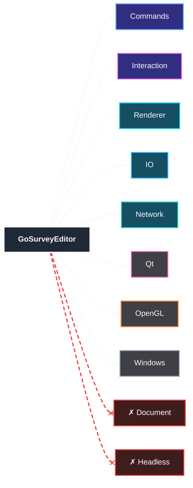

### Interaction

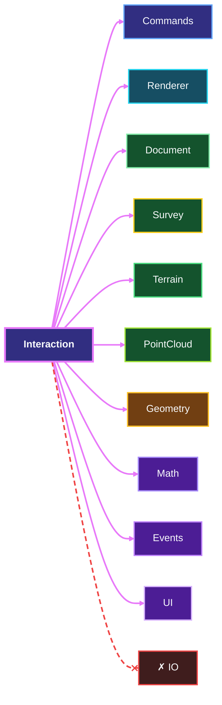

### Commands

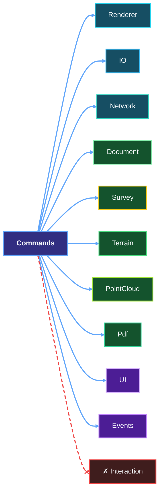

### Renderer

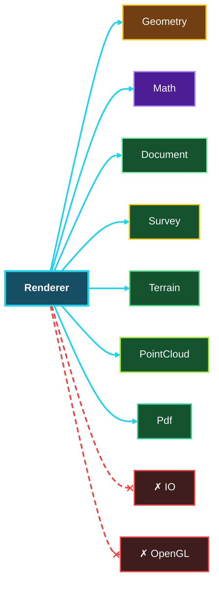

### IO

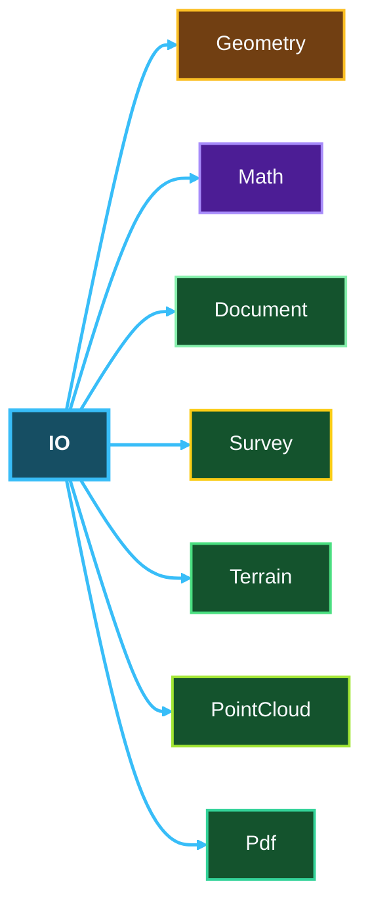

### Network

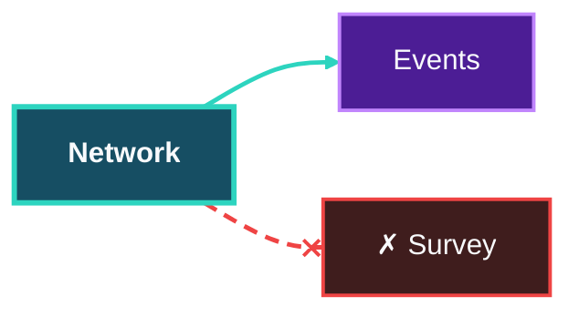

### Document

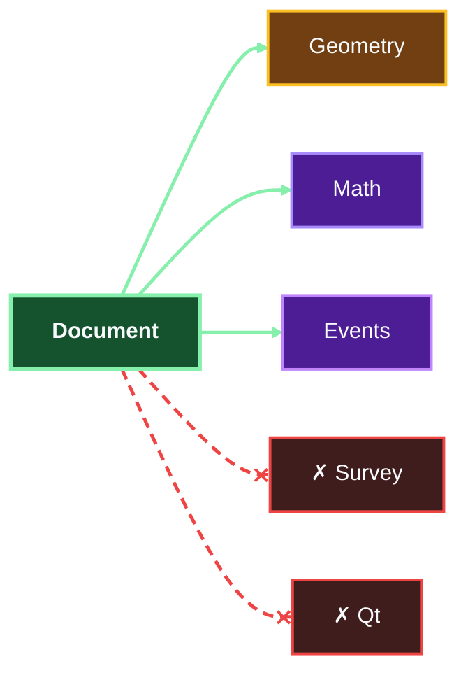

### Survey

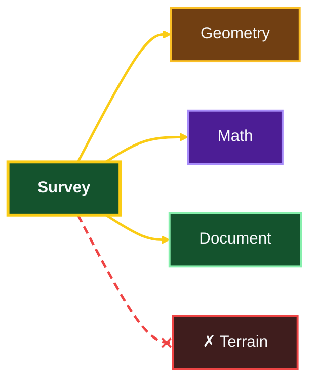

### Terrain

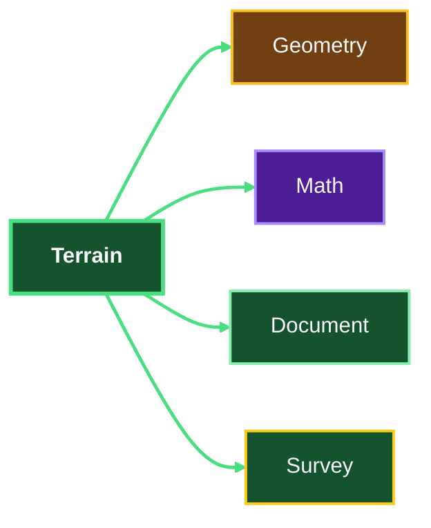

### PointCloud

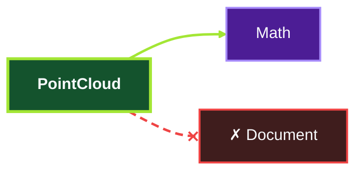

### Pdf

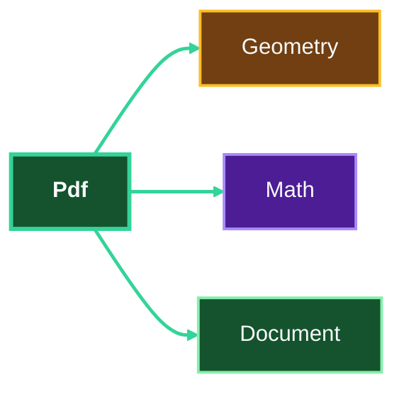

### Geometry

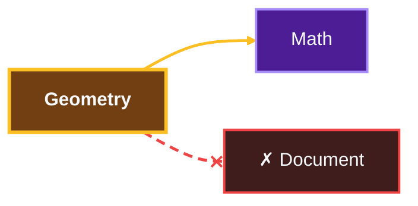

### Math


### Events


### UI


### Debug


### Core


### Qt

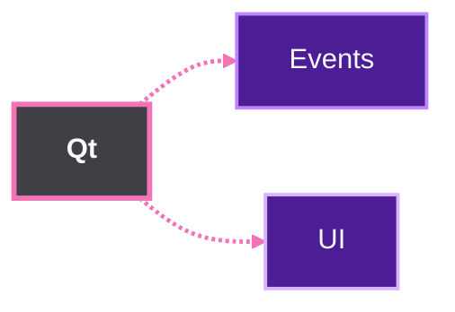

### OpenGL

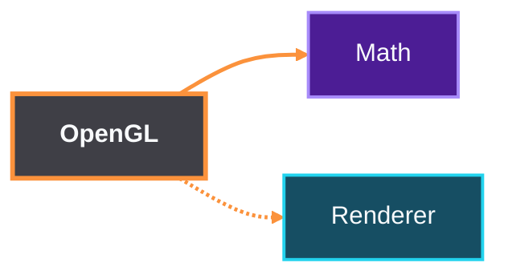

### Windows

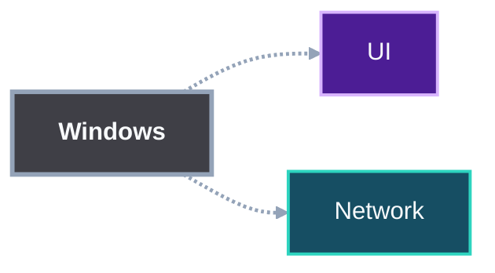

### Headless

```mermaid
flowchart LR
  phead__src["<b>Headless</b>"]
  phead__events["Events"]
  phead__ui["UI"]
  phead__renderer["Renderer"]
  phead__src -.-> phead__events
  phead__src -.-> phead__ui
  phead__src -.-> phead__renderer
  style phead__src fill:#3f3f46,stroke:#d1d5db,stroke-width:3px,color:#f8fafc
  style phead__events fill:#4c1d95,stroke:#c084fc,stroke-width:2px,color:#f8fafc
  style phead__ui fill:#4c1d95,stroke:#d8b4fe,stroke-width:2px,color:#f8fafc
  style phead__renderer fill:#164e63,stroke:#22d3ee,stroke-width:2px,color:#f8fafc
  linkStyle 0 stroke:#d1d5db,stroke-width:2.5px
  linkStyle 1 stroke:#d1d5db,stroke-width:2.5px
  linkStyle 2 stroke:#d1d5db,stroke-width:2.5px
```

## 2. Feature dependencies (proposed)

Each arrow runs from a feature to the feature it uses; "System · all" means the whole system.
This level is a **proposal** derived from the target architecture: the system map and ADRs define
only system-level edges. Every feature arrow lies on an allowed system edge from section 1, and
the generator checks this.

### GoSurveyEditor features

```mermaid
flowchart LR
  subgraph editor__SRC["GoSurveyEditor"]
    direction TB
    editor__start["startup · composition"]
    editor__win["windows"]
    editor__dlg["dialogs"]
    editor__ribbon["ribbon"]
    editor__panels["panels"]
    editor__keys["hotkeys"]
  end
  editor__t_commands_reg["Commands · registry"]
  editor__t_pgl_dev["OpenGL · render device"]
  editor__t_pqt_ui["Qt · UI adapter"]
  editor__t_pwin_crash["Windows · crash"]
  editor__t_network_upd["Network · updates"]
  editor__t_renderer_cam["Renderer · camera"]
  editor__t_interaction_pick["Interaction · picking"]
  editor__t_io["IO · all"]
  editor__t_commands_fam["Commands · command families"]
  editor__start --> editor__t_commands_reg
  editor__start --> editor__t_pgl_dev
  editor__start --> editor__t_pqt_ui
  editor__start --> editor__t_pwin_crash
  editor__start --> editor__t_network_upd
  editor__win --> editor__t_renderer_cam
  editor__win --> editor__t_interaction_pick
  editor__dlg --> editor__t_pqt_ui
  editor__dlg --> editor__t_io
  editor__ribbon --> editor__t_commands_reg
  editor__keys --> editor__t_commands_reg
  editor__panels --> editor__t_commands_fam
  style editor__SRC fill:#27272a,stroke:#f8fafc,stroke-width:3px,color:#f8fafc
  style editor__start fill:#1f2937,stroke:#f8fafc,stroke-width:2px,color:#f8fafc
  style editor__win fill:#1f2937,stroke:#f8fafc,stroke-width:2px,color:#f8fafc
  style editor__dlg fill:#1f2937,stroke:#f8fafc,stroke-width:2px,color:#f8fafc
  style editor__ribbon fill:#1f2937,stroke:#f8fafc,stroke-width:2px,color:#f8fafc
  style editor__panels fill:#1f2937,stroke:#f8fafc,stroke-width:2px,color:#f8fafc
  style editor__keys fill:#1f2937,stroke:#f8fafc,stroke-width:2px,color:#f8fafc
  style editor__t_commands_reg fill:#312e81,stroke:#60a5fa,stroke-width:2px,color:#f8fafc
  style editor__t_pgl_dev fill:#3f3f46,stroke:#fb923c,stroke-width:2px,color:#f8fafc
  style editor__t_pqt_ui fill:#3f3f46,stroke:#f472b6,stroke-width:2px,color:#f8fafc
  style editor__t_pwin_crash fill:#3f3f46,stroke:#94a3b8,stroke-width:2px,color:#f8fafc
  style editor__t_network_upd fill:#164e63,stroke:#2dd4bf,stroke-width:2px,color:#f8fafc
  style editor__t_renderer_cam fill:#164e63,stroke:#22d3ee,stroke-width:2px,color:#f8fafc
  style editor__t_interaction_pick fill:#312e81,stroke:#e879f9,stroke-width:2px,color:#f8fafc
  style editor__t_io fill:#164e63,stroke:#38bdf8,stroke-width:2px,color:#f8fafc
  style editor__t_commands_fam fill:#312e81,stroke:#60a5fa,stroke-width:2px,color:#f8fafc
  linkStyle 0 stroke:#f8fafc,stroke-width:2.5px
  linkStyle 1 stroke:#f8fafc,stroke-width:2.5px
  linkStyle 2 stroke:#f8fafc,stroke-width:2.5px
  linkStyle 3 stroke:#f8fafc,stroke-width:2.5px
  linkStyle 4 stroke:#f8fafc,stroke-width:2.5px
  linkStyle 5 stroke:#f8fafc,stroke-width:2.5px
  linkStyle 6 stroke:#f8fafc,stroke-width:2.5px
  linkStyle 7 stroke:#f8fafc,stroke-width:2.5px
  linkStyle 8 stroke:#f8fafc,stroke-width:2.5px
  linkStyle 9 stroke:#f8fafc,stroke-width:2.5px
  linkStyle 10 stroke:#f8fafc,stroke-width:2.5px
  linkStyle 11 stroke:#f8fafc,stroke-width:2.5px
```

### Interaction features

```mermaid
flowchart LR
  subgraph interaction__SRC["Interaction"]
    direction TB
    interaction__snap["snap"]
    interaction__grips["grips"]
    interaction__prev["previews"]
    interaction__pick["picking"]
  end
  interaction__t_document_ent["Document · entities"]
  interaction__t_survey_pts["Survey · points"]
  interaction__t_geometry_curves["Geometry · curves"]
  interaction__t_math_ucs["Math · UCS"]
  interaction__t_commands_fam["Commands · command families"]
  interaction__t_renderer_lists["Renderer · draw lists"]
  interaction__t_renderer_cam["Renderer · camera"]
  interaction__t_math_rays["Math · rays"]
  interaction__t_document_sel["Document · selection"]
  interaction__t_pointcloud_oct["PointCloud · octree"]
  interaction__t_events_input["Events · input"]
  interaction__t_terrain_tin["Terrain · TIN"]
  interaction__snap --> interaction__t_document_ent
  interaction__snap --> interaction__t_survey_pts
  interaction__snap --> interaction__t_geometry_curves
  interaction__snap --> interaction__t_math_ucs
  interaction__grips --> interaction__t_document_ent
  interaction__grips --> interaction__t_commands_fam
  interaction__prev --> interaction__t_renderer_lists
  interaction__prev --> interaction__t_commands_fam
  interaction__pick --> interaction__t_renderer_cam
  interaction__pick --> interaction__t_math_rays
  interaction__pick --> interaction__t_document_sel
  interaction__pick --> interaction__t_pointcloud_oct
  interaction__pick --> interaction__t_events_input
  interaction__pick --> interaction__t_terrain_tin
  style interaction__SRC fill:#27272a,stroke:#e879f9,stroke-width:3px,color:#f8fafc
  style interaction__snap fill:#312e81,stroke:#e879f9,stroke-width:2px,color:#f8fafc
  style interaction__grips fill:#312e81,stroke:#e879f9,stroke-width:2px,color:#f8fafc
  style interaction__prev fill:#312e81,stroke:#e879f9,stroke-width:2px,color:#f8fafc
  style interaction__pick fill:#312e81,stroke:#e879f9,stroke-width:2px,color:#f8fafc
  style interaction__t_document_ent fill:#14532d,stroke:#86efac,stroke-width:2px,color:#f8fafc
  style interaction__t_survey_pts fill:#14532d,stroke:#facc15,stroke-width:2px,color:#f8fafc
  style interaction__t_geometry_curves fill:#713f12,stroke:#fbbf24,stroke-width:2px,color:#f8fafc
  style interaction__t_math_ucs fill:#4c1d95,stroke:#a78bfa,stroke-width:2px,color:#f8fafc
  style interaction__t_commands_fam fill:#312e81,stroke:#60a5fa,stroke-width:2px,color:#f8fafc
  style interaction__t_renderer_lists fill:#164e63,stroke:#22d3ee,stroke-width:2px,color:#f8fafc
  style interaction__t_renderer_cam fill:#164e63,stroke:#22d3ee,stroke-width:2px,color:#f8fafc
  style interaction__t_math_rays fill:#4c1d95,stroke:#a78bfa,stroke-width:2px,color:#f8fafc
  style interaction__t_document_sel fill:#14532d,stroke:#86efac,stroke-width:2px,color:#f8fafc
  style interaction__t_pointcloud_oct fill:#14532d,stroke:#a3e635,stroke-width:2px,color:#f8fafc
  style interaction__t_events_input fill:#4c1d95,stroke:#c084fc,stroke-width:2px,color:#f8fafc
  style interaction__t_terrain_tin fill:#14532d,stroke:#4ade80,stroke-width:2px,color:#f8fafc
  linkStyle 0 stroke:#e879f9,stroke-width:2.5px
  linkStyle 1 stroke:#e879f9,stroke-width:2.5px
  linkStyle 2 stroke:#e879f9,stroke-width:2.5px
  linkStyle 3 stroke:#e879f9,stroke-width:2.5px
  linkStyle 4 stroke:#e879f9,stroke-width:2.5px
  linkStyle 5 stroke:#e879f9,stroke-width:2.5px
  linkStyle 6 stroke:#e879f9,stroke-width:2.5px
  linkStyle 7 stroke:#e879f9,stroke-width:2.5px
  linkStyle 8 stroke:#e879f9,stroke-width:2.5px
  linkStyle 9 stroke:#e879f9,stroke-width:2.5px
  linkStyle 10 stroke:#e879f9,stroke-width:2.5px
  linkStyle 11 stroke:#e879f9,stroke-width:2.5px
  linkStyle 12 stroke:#e879f9,stroke-width:2.5px
  linkStyle 13 stroke:#e879f9,stroke-width:2.5px
```

### Commands features

```mermaid
flowchart LR
  subgraph commands__SRC["Commands"]
    direction TB
    commands__reg["registry"]
    commands__fam["command families"]
  end
  commands__t_ui_dlg["UI · dialogs"]
  commands__t_events_input["Events · input"]
  commands__t_document_undo["Document · undo"]
  commands__t_document_ent["Document · entities"]
  commands__t_survey_trav["Survey · traverse"]
  commands__t_terrain_vol["Terrain · volumes"]
  commands__t_pdf_meas["Pdf · measure"]
  commands__t_pointcloud_store["PointCloud · storage"]
  commands__t_io["IO · all"]
  commands__t_network_tiles["Network · map tiles"]
  commands__t_ui_prog["UI · progress"]
  commands__t_renderer_cam["Renderer · camera"]
  commands__reg --> commands__t_ui_dlg
  commands__reg --> commands__t_events_input
  commands__fam --> commands__t_document_undo
  commands__fam --> commands__t_document_ent
  commands__fam --> commands__t_survey_trav
  commands__fam --> commands__t_terrain_vol
  commands__fam --> commands__t_pdf_meas
  commands__fam --> commands__t_pointcloud_store
  commands__fam --> commands__t_io
  commands__fam --> commands__t_network_tiles
  commands__fam --> commands__t_ui_prog
  commands__fam --> commands__t_renderer_cam
  style commands__SRC fill:#27272a,stroke:#60a5fa,stroke-width:3px,color:#f8fafc
  style commands__reg fill:#312e81,stroke:#60a5fa,stroke-width:2px,color:#f8fafc
  style commands__fam fill:#312e81,stroke:#60a5fa,stroke-width:2px,color:#f8fafc
  style commands__t_ui_dlg fill:#4c1d95,stroke:#d8b4fe,stroke-width:2px,color:#f8fafc
  style commands__t_events_input fill:#4c1d95,stroke:#c084fc,stroke-width:2px,color:#f8fafc
  style commands__t_document_undo fill:#14532d,stroke:#86efac,stroke-width:2px,color:#f8fafc
  style commands__t_document_ent fill:#14532d,stroke:#86efac,stroke-width:2px,color:#f8fafc
  style commands__t_survey_trav fill:#14532d,stroke:#facc15,stroke-width:2px,color:#f8fafc
  style commands__t_terrain_vol fill:#14532d,stroke:#4ade80,stroke-width:2px,color:#f8fafc
  style commands__t_pdf_meas fill:#14532d,stroke:#34d399,stroke-width:2px,color:#f8fafc
  style commands__t_pointcloud_store fill:#14532d,stroke:#a3e635,stroke-width:2px,color:#f8fafc
  style commands__t_io fill:#164e63,stroke:#38bdf8,stroke-width:2px,color:#f8fafc
  style commands__t_network_tiles fill:#164e63,stroke:#2dd4bf,stroke-width:2px,color:#f8fafc
  style commands__t_ui_prog fill:#4c1d95,stroke:#d8b4fe,stroke-width:2px,color:#f8fafc
  style commands__t_renderer_cam fill:#164e63,stroke:#22d3ee,stroke-width:2px,color:#f8fafc
  linkStyle 0 stroke:#60a5fa,stroke-width:2.5px
  linkStyle 1 stroke:#60a5fa,stroke-width:2.5px
  linkStyle 2 stroke:#60a5fa,stroke-width:2.5px
  linkStyle 3 stroke:#60a5fa,stroke-width:2.5px
  linkStyle 4 stroke:#60a5fa,stroke-width:2.5px
  linkStyle 5 stroke:#60a5fa,stroke-width:2.5px
  linkStyle 6 stroke:#60a5fa,stroke-width:2.5px
  linkStyle 7 stroke:#60a5fa,stroke-width:2.5px
  linkStyle 8 stroke:#60a5fa,stroke-width:2.5px
  linkStyle 9 stroke:#60a5fa,stroke-width:2.5px
  linkStyle 10 stroke:#60a5fa,stroke-width:2.5px
  linkStyle 11 stroke:#60a5fa,stroke-width:2.5px
```

### Renderer features

```mermaid
flowchart LR
  subgraph renderer__SRC["Renderer"]
    direction TB
    renderer__cam["camera"]
    renderer__lists["draw lists"]
    renderer__cache["caches"]
    renderer__dev["device interfaces"]
  end
  renderer__t_math_mat["Math · matrices"]
  renderer__t_math_ucs["Math · UCS"]
  renderer__t_document_ent["Document · entities"]
  renderer__t_document_lay["Document · layers"]
  renderer__t_survey_pts["Survey · points"]
  renderer__t_terrain_cont["Terrain · contours"]
  renderer__t_pointcloud_oct["PointCloud · octree"]
  renderer__t_pdf_ann["Pdf · annotate"]
  renderer__t_geometry_mesh["Geometry · mesh"]
  renderer__t_document_undo["Document · undo"]
  renderer__cam --> renderer__t_math_mat
  renderer__cam --> renderer__t_math_ucs
  renderer__lists --> renderer__t_document_ent
  renderer__lists --> renderer__t_document_lay
  renderer__lists --> renderer__t_survey_pts
  renderer__lists --> renderer__t_terrain_cont
  renderer__lists --> renderer__t_pointcloud_oct
  renderer__lists --> renderer__t_pdf_ann
  renderer__lists --> renderer__t_geometry_mesh
  renderer__cache --> renderer__lists
  renderer__cache --> renderer__t_document_undo
  renderer__lists --> renderer__dev
  style renderer__SRC fill:#27272a,stroke:#22d3ee,stroke-width:3px,color:#f8fafc
  style renderer__cam fill:#164e63,stroke:#22d3ee,stroke-width:2px,color:#f8fafc
  style renderer__lists fill:#164e63,stroke:#22d3ee,stroke-width:2px,color:#f8fafc
  style renderer__cache fill:#164e63,stroke:#22d3ee,stroke-width:2px,color:#f8fafc
  style renderer__dev fill:#164e63,stroke:#22d3ee,stroke-width:2px,color:#f8fafc
  style renderer__t_math_mat fill:#4c1d95,stroke:#a78bfa,stroke-width:2px,color:#f8fafc
  style renderer__t_math_ucs fill:#4c1d95,stroke:#a78bfa,stroke-width:2px,color:#f8fafc
  style renderer__t_document_ent fill:#14532d,stroke:#86efac,stroke-width:2px,color:#f8fafc
  style renderer__t_document_lay fill:#14532d,stroke:#86efac,stroke-width:2px,color:#f8fafc
  style renderer__t_survey_pts fill:#14532d,stroke:#facc15,stroke-width:2px,color:#f8fafc
  style renderer__t_terrain_cont fill:#14532d,stroke:#4ade80,stroke-width:2px,color:#f8fafc
  style renderer__t_pointcloud_oct fill:#14532d,stroke:#a3e635,stroke-width:2px,color:#f8fafc
  style renderer__t_pdf_ann fill:#14532d,stroke:#34d399,stroke-width:2px,color:#f8fafc
  style renderer__t_geometry_mesh fill:#713f12,stroke:#fbbf24,stroke-width:2px,color:#f8fafc
  style renderer__t_document_undo fill:#14532d,stroke:#86efac,stroke-width:2px,color:#f8fafc
  linkStyle 0 stroke:#22d3ee,stroke-width:2.5px
  linkStyle 1 stroke:#22d3ee,stroke-width:2.5px
  linkStyle 2 stroke:#22d3ee,stroke-width:2.5px
  linkStyle 3 stroke:#22d3ee,stroke-width:2.5px
  linkStyle 4 stroke:#22d3ee,stroke-width:2.5px
  linkStyle 5 stroke:#22d3ee,stroke-width:2.5px
  linkStyle 6 stroke:#22d3ee,stroke-width:2.5px
  linkStyle 7 stroke:#22d3ee,stroke-width:2.5px
  linkStyle 8 stroke:#22d3ee,stroke-width:2.5px
  linkStyle 9 stroke:#22d3ee,stroke-width:2.5px
  linkStyle 10 stroke:#22d3ee,stroke-width:2.5px
  linkStyle 11 stroke:#22d3ee,stroke-width:2.5px
```

### IO features

```mermaid
flowchart LR
  subgraph io__SRC["IO"]
    direction TB
    io__dxf["DXF"]
    io__dwg["DWG"]
    io__gltf["glTF"]
    io__stl["STL"]
    io__sat["SAT"]
    io__pts["point files"]
    io__starnet["StarNet"]
  end
  io__t_document["Document · all"]
  io__t_geometry_nurbs["Geometry · NURBS"]
  io__t_geometry_mesh["Geometry · mesh"]
  io__t_geometry_brep["Geometry · B-rep"]
  io__t_survey_pts["Survey · points"]
  io__t_pointcloud_store["PointCloud · storage"]
  io__t_survey_trav["Survey · traverse"]
  io__dxf --> io__t_document
  io__dxf --> io__t_geometry_nurbs
  io__dwg --> io__t_document
  io__dwg --> io__t_geometry_nurbs
  io__gltf --> io__t_geometry_mesh
  io__stl --> io__t_geometry_mesh
  io__sat --> io__t_geometry_brep
  io__pts --> io__t_survey_pts
  io__pts --> io__t_pointcloud_store
  io__starnet --> io__t_survey_trav
  style io__SRC fill:#27272a,stroke:#38bdf8,stroke-width:3px,color:#f8fafc
  style io__dxf fill:#164e63,stroke:#38bdf8,stroke-width:2px,color:#f8fafc
  style io__dwg fill:#164e63,stroke:#38bdf8,stroke-width:2px,color:#f8fafc
  style io__gltf fill:#164e63,stroke:#38bdf8,stroke-width:2px,color:#f8fafc
  style io__stl fill:#164e63,stroke:#38bdf8,stroke-width:2px,color:#f8fafc
  style io__sat fill:#164e63,stroke:#38bdf8,stroke-width:2px,color:#f8fafc
  style io__pts fill:#164e63,stroke:#38bdf8,stroke-width:2px,color:#f8fafc
  style io__starnet fill:#164e63,stroke:#38bdf8,stroke-width:2px,color:#f8fafc
  style io__t_document fill:#14532d,stroke:#86efac,stroke-width:2px,color:#f8fafc
  style io__t_geometry_nurbs fill:#713f12,stroke:#fbbf24,stroke-width:2px,color:#f8fafc
  style io__t_geometry_mesh fill:#713f12,stroke:#fbbf24,stroke-width:2px,color:#f8fafc
  style io__t_geometry_brep fill:#713f12,stroke:#fbbf24,stroke-width:2px,color:#f8fafc
  style io__t_survey_pts fill:#14532d,stroke:#facc15,stroke-width:2px,color:#f8fafc
  style io__t_pointcloud_store fill:#14532d,stroke:#a3e635,stroke-width:2px,color:#f8fafc
  style io__t_survey_trav fill:#14532d,stroke:#facc15,stroke-width:2px,color:#f8fafc
  linkStyle 0 stroke:#38bdf8,stroke-width:2.5px
  linkStyle 1 stroke:#38bdf8,stroke-width:2.5px
  linkStyle 2 stroke:#38bdf8,stroke-width:2.5px
  linkStyle 3 stroke:#38bdf8,stroke-width:2.5px
  linkStyle 4 stroke:#38bdf8,stroke-width:2.5px
  linkStyle 5 stroke:#38bdf8,stroke-width:2.5px
  linkStyle 6 stroke:#38bdf8,stroke-width:2.5px
  linkStyle 7 stroke:#38bdf8,stroke-width:2.5px
  linkStyle 8 stroke:#38bdf8,stroke-width:2.5px
  linkStyle 9 stroke:#38bdf8,stroke-width:2.5px
```

### Network features

```mermaid
flowchart LR
  subgraph network__SRC["Network"]
    direction TB
    network__tiles["map tiles"]
    network__upd["updates"]
    network__tel["telemetry"]
    network__xport["transport interface"]
  end
  network__t_core_set["Core · settings"]
  network__t_core_log["Core · logging"]
  network__tiles --> network__xport
  network__upd --> network__xport
  network__tel --> network__xport
  network__upd --> network__t_core_set
  network__tel --> network__t_core_log
  style network__SRC fill:#27272a,stroke:#2dd4bf,stroke-width:3px,color:#f8fafc
  style network__tiles fill:#164e63,stroke:#2dd4bf,stroke-width:2px,color:#f8fafc
  style network__upd fill:#164e63,stroke:#2dd4bf,stroke-width:2px,color:#f8fafc
  style network__tel fill:#164e63,stroke:#2dd4bf,stroke-width:2px,color:#f8fafc
  style network__xport fill:#164e63,stroke:#2dd4bf,stroke-width:2px,color:#f8fafc
  style network__t_core_set fill:#4c1d95,stroke:#c4b5fd,stroke-width:2px,color:#f8fafc
  style network__t_core_log fill:#4c1d95,stroke:#c4b5fd,stroke-width:2px,color:#f8fafc
  linkStyle 0 stroke:#2dd4bf,stroke-width:2.5px
  linkStyle 1 stroke:#2dd4bf,stroke-width:2.5px
  linkStyle 2 stroke:#2dd4bf,stroke-width:2.5px
  linkStyle 3 stroke:#2dd4bf,stroke-width:2.5px
  linkStyle 4 stroke:#2dd4bf,stroke-width:2.5px
```

### Document features

```mermaid
flowchart LR
  subgraph document__SRC["Document"]
    direction TB
    document__ent["entities"]
    document__lay["layers"]
    document__blk["blocks"]
    document__tbl["tables"]
    document__txt["text"]
    document__undo["undo"]
    document__sel["selection"]
  end
  document__t_geometry["Geometry · all"]
  document__t_core_fmt["Core · formatting"]
  document__t_events_docchg["Events · document changes"]
  document__ent --> document__t_geometry
  document__blk --> document__ent
  document__lay --> document__ent
  document__txt --> document__t_core_fmt
  document__tbl --> document__txt
  document__undo --> document__t_events_docchg
  document__sel --> document__ent
  style document__SRC fill:#27272a,stroke:#86efac,stroke-width:3px,color:#f8fafc
  style document__ent fill:#14532d,stroke:#86efac,stroke-width:2px,color:#f8fafc
  style document__lay fill:#14532d,stroke:#86efac,stroke-width:2px,color:#f8fafc
  style document__blk fill:#14532d,stroke:#86efac,stroke-width:2px,color:#f8fafc
  style document__tbl fill:#14532d,stroke:#86efac,stroke-width:2px,color:#f8fafc
  style document__txt fill:#14532d,stroke:#86efac,stroke-width:2px,color:#f8fafc
  style document__undo fill:#14532d,stroke:#86efac,stroke-width:2px,color:#f8fafc
  style document__sel fill:#14532d,stroke:#86efac,stroke-width:2px,color:#f8fafc
  style document__t_geometry fill:#713f12,stroke:#fbbf24,stroke-width:2px,color:#f8fafc
  style document__t_core_fmt fill:#4c1d95,stroke:#c4b5fd,stroke-width:2px,color:#f8fafc
  style document__t_events_docchg fill:#4c1d95,stroke:#c084fc,stroke-width:2px,color:#f8fafc
  linkStyle 0 stroke:#86efac,stroke-width:2.5px
  linkStyle 1 stroke:#86efac,stroke-width:2.5px
  linkStyle 2 stroke:#86efac,stroke-width:2.5px
  linkStyle 3 stroke:#86efac,stroke-width:2.5px
  linkStyle 4 stroke:#86efac,stroke-width:2.5px
  linkStyle 5 stroke:#86efac,stroke-width:2.5px
  linkStyle 6 stroke:#86efac,stroke-width:2.5px
```

### Survey features

```mermaid
flowchart LR
  subgraph survey__SRC["Survey"]
    direction TB
    survey__pts["points"]
    survey__trav["traverse"]
    survey__align["alignment"]
    survey__crs["coordinate systems"]
  end
  survey__t_document_ent["Document · entities"]
  survey__t_math_vec["Math · vectors"]
  survey__t_core_units["Core · units"]
  survey__t_geometry_curves["Geometry · curves"]
  survey__t_math_mat["Math · matrices"]
  survey__pts --> survey__t_document_ent
  survey__pts --> survey__t_math_vec
  survey__trav --> survey__pts
  survey__trav --> survey__t_core_units
  survey__align --> survey__t_geometry_curves
  survey__crs --> survey__t_math_mat
  style survey__SRC fill:#27272a,stroke:#facc15,stroke-width:3px,color:#f8fafc
  style survey__pts fill:#14532d,stroke:#facc15,stroke-width:2px,color:#f8fafc
  style survey__trav fill:#14532d,stroke:#facc15,stroke-width:2px,color:#f8fafc
  style survey__align fill:#14532d,stroke:#facc15,stroke-width:2px,color:#f8fafc
  style survey__crs fill:#14532d,stroke:#facc15,stroke-width:2px,color:#f8fafc
  style survey__t_document_ent fill:#14532d,stroke:#86efac,stroke-width:2px,color:#f8fafc
  style survey__t_math_vec fill:#4c1d95,stroke:#a78bfa,stroke-width:2px,color:#f8fafc
  style survey__t_core_units fill:#4c1d95,stroke:#c4b5fd,stroke-width:2px,color:#f8fafc
  style survey__t_geometry_curves fill:#713f12,stroke:#fbbf24,stroke-width:2px,color:#f8fafc
  style survey__t_math_mat fill:#4c1d95,stroke:#a78bfa,stroke-width:2px,color:#f8fafc
  linkStyle 0 stroke:#facc15,stroke-width:2.5px
  linkStyle 1 stroke:#facc15,stroke-width:2.5px
  linkStyle 2 stroke:#facc15,stroke-width:2.5px
  linkStyle 3 stroke:#facc15,stroke-width:2.5px
  linkStyle 4 stroke:#facc15,stroke-width:2.5px
  linkStyle 5 stroke:#facc15,stroke-width:2.5px
```

### Terrain features

```mermaid
flowchart LR
  subgraph terrain__SRC["Terrain"]
    direction TB
    terrain__tin["TIN"]
    terrain__cont["contours"]
    terrain__vol["volumes"]
    terrain__day["daylight"]
  end
  terrain__t_survey_pts["Survey · points"]
  terrain__t_geometry_mesh["Geometry · mesh"]
  terrain__t_geometry_curves["Geometry · curves"]
  terrain__t_document_ent["Document · entities"]
  terrain__t_survey_align["Survey · alignment"]
  terrain__tin --> terrain__t_survey_pts
  terrain__tin --> terrain__t_geometry_mesh
  terrain__cont --> terrain__tin
  terrain__cont --> terrain__t_geometry_curves
  terrain__cont --> terrain__t_document_ent
  terrain__vol --> terrain__tin
  terrain__day --> terrain__t_survey_align
  terrain__day --> terrain__tin
  style terrain__SRC fill:#27272a,stroke:#4ade80,stroke-width:3px,color:#f8fafc
  style terrain__tin fill:#14532d,stroke:#4ade80,stroke-width:2px,color:#f8fafc
  style terrain__cont fill:#14532d,stroke:#4ade80,stroke-width:2px,color:#f8fafc
  style terrain__vol fill:#14532d,stroke:#4ade80,stroke-width:2px,color:#f8fafc
  style terrain__day fill:#14532d,stroke:#4ade80,stroke-width:2px,color:#f8fafc
  style terrain__t_survey_pts fill:#14532d,stroke:#facc15,stroke-width:2px,color:#f8fafc
  style terrain__t_geometry_mesh fill:#713f12,stroke:#fbbf24,stroke-width:2px,color:#f8fafc
  style terrain__t_geometry_curves fill:#713f12,stroke:#fbbf24,stroke-width:2px,color:#f8fafc
  style terrain__t_document_ent fill:#14532d,stroke:#86efac,stroke-width:2px,color:#f8fafc
  style terrain__t_survey_align fill:#14532d,stroke:#facc15,stroke-width:2px,color:#f8fafc
  linkStyle 0 stroke:#4ade80,stroke-width:2.5px
  linkStyle 1 stroke:#4ade80,stroke-width:2.5px
  linkStyle 2 stroke:#4ade80,stroke-width:2.5px
  linkStyle 3 stroke:#4ade80,stroke-width:2.5px
  linkStyle 4 stroke:#4ade80,stroke-width:2.5px
  linkStyle 5 stroke:#4ade80,stroke-width:2.5px
  linkStyle 6 stroke:#4ade80,stroke-width:2.5px
  linkStyle 7 stroke:#4ade80,stroke-width:2.5px
```

### PointCloud features

```mermaid
flowchart LR
  subgraph pointcloud__SRC["PointCloud"]
    direction TB
    pointcloud__store["storage"]
    pointcloud__oct["octree"]
    pointcloud__cache["cache"]
  end
  pointcloud__t_math_vec["Math · vectors"]
  pointcloud__t_core_set["Core · settings"]
  pointcloud__oct --> pointcloud__store
  pointcloud__store --> pointcloud__t_math_vec
  pointcloud__cache --> pointcloud__t_core_set
  style pointcloud__SRC fill:#27272a,stroke:#a3e635,stroke-width:3px,color:#f8fafc
  style pointcloud__store fill:#14532d,stroke:#a3e635,stroke-width:2px,color:#f8fafc
  style pointcloud__oct fill:#14532d,stroke:#a3e635,stroke-width:2px,color:#f8fafc
  style pointcloud__cache fill:#14532d,stroke:#a3e635,stroke-width:2px,color:#f8fafc
  style pointcloud__t_math_vec fill:#4c1d95,stroke:#a78bfa,stroke-width:2px,color:#f8fafc
  style pointcloud__t_core_set fill:#4c1d95,stroke:#c4b5fd,stroke-width:2px,color:#f8fafc
  linkStyle 0 stroke:#a3e635,stroke-width:2.5px
  linkStyle 1 stroke:#a3e635,stroke-width:2.5px
  linkStyle 2 stroke:#a3e635,stroke-width:2.5px
```

### Pdf features

```mermaid
flowchart LR
  subgraph pdf__SRC["Pdf"]
    direction TB
    pdf__ann["annotate"]
    pdf__meas["measure"]
    pdf__cmp["compare"]
    pdf__scale["scale"]
  end
  pdf__t_document_ent["Document · entities"]
  pdf__t_geometry_g2d["Geometry · geom2d"]
  pdf__t_math_mat["Math · matrices"]
  pdf__ann --> pdf__t_document_ent
  pdf__meas --> pdf__t_geometry_g2d
  pdf__cmp --> pdf__t_geometry_g2d
  pdf__scale --> pdf__t_math_mat
  style pdf__SRC fill:#27272a,stroke:#34d399,stroke-width:3px,color:#f8fafc
  style pdf__ann fill:#14532d,stroke:#34d399,stroke-width:2px,color:#f8fafc
  style pdf__meas fill:#14532d,stroke:#34d399,stroke-width:2px,color:#f8fafc
  style pdf__cmp fill:#14532d,stroke:#34d399,stroke-width:2px,color:#f8fafc
  style pdf__scale fill:#14532d,stroke:#34d399,stroke-width:2px,color:#f8fafc
  style pdf__t_document_ent fill:#14532d,stroke:#86efac,stroke-width:2px,color:#f8fafc
  style pdf__t_geometry_g2d fill:#713f12,stroke:#fbbf24,stroke-width:2px,color:#f8fafc
  style pdf__t_math_mat fill:#4c1d95,stroke:#a78bfa,stroke-width:2px,color:#f8fafc
  linkStyle 0 stroke:#34d399,stroke-width:2.5px
  linkStyle 1 stroke:#34d399,stroke-width:2.5px
  linkStyle 2 stroke:#34d399,stroke-width:2.5px
  linkStyle 3 stroke:#34d399,stroke-width:2.5px
```

### Geometry features

```mermaid
flowchart LR
  subgraph geometry__SRC["Geometry"]
    direction TB
    geometry__g2d["geom2d"]
    geometry__curves["curves"]
    geometry__nurbs["NURBS"]
    geometry__brep["B-rep"]
    geometry__mesh["mesh"]
  end
  geometry__t_math_vec["Math · vectors"]
  geometry__nurbs --> geometry__curves
  geometry__brep --> geometry__nurbs
  geometry__brep --> geometry__mesh
  geometry__curves --> geometry__t_math_vec
  geometry__mesh --> geometry__t_math_vec
  geometry__g2d --> geometry__t_math_vec
  style geometry__SRC fill:#27272a,stroke:#fbbf24,stroke-width:3px,color:#f8fafc
  style geometry__g2d fill:#713f12,stroke:#fbbf24,stroke-width:2px,color:#f8fafc
  style geometry__curves fill:#713f12,stroke:#fbbf24,stroke-width:2px,color:#f8fafc
  style geometry__nurbs fill:#713f12,stroke:#fbbf24,stroke-width:2px,color:#f8fafc
  style geometry__brep fill:#713f12,stroke:#fbbf24,stroke-width:2px,color:#f8fafc
  style geometry__mesh fill:#713f12,stroke:#fbbf24,stroke-width:2px,color:#f8fafc
  style geometry__t_math_vec fill:#4c1d95,stroke:#a78bfa,stroke-width:2px,color:#f8fafc
  linkStyle 0 stroke:#fbbf24,stroke-width:2.5px
  linkStyle 1 stroke:#fbbf24,stroke-width:2.5px
  linkStyle 2 stroke:#fbbf24,stroke-width:2.5px
  linkStyle 3 stroke:#fbbf24,stroke-width:2.5px
  linkStyle 4 stroke:#fbbf24,stroke-width:2.5px
  linkStyle 5 stroke:#fbbf24,stroke-width:2.5px
```

### Math features

```mermaid
flowchart LR
  subgraph math__SRC["Math"]
    direction TB
    math__vec["vectors"]
    math__mat["matrices"]
    math__rays["rays"]
    math__ucs["UCS"]
  end
  math__ucs --> math__mat
  math__rays --> math__vec
  math__mat --> math__vec
  style math__SRC fill:#27272a,stroke:#a78bfa,stroke-width:3px,color:#f8fafc
  style math__vec fill:#4c1d95,stroke:#a78bfa,stroke-width:2px,color:#f8fafc
  style math__mat fill:#4c1d95,stroke:#a78bfa,stroke-width:2px,color:#f8fafc
  style math__rays fill:#4c1d95,stroke:#a78bfa,stroke-width:2px,color:#f8fafc
  style math__ucs fill:#4c1d95,stroke:#a78bfa,stroke-width:2px,color:#f8fafc
  linkStyle 0 stroke:#a78bfa,stroke-width:2.5px
  linkStyle 1 stroke:#a78bfa,stroke-width:2.5px
  linkStyle 2 stroke:#a78bfa,stroke-width:2.5px
```

### Events features

```mermaid
flowchart LR
  subgraph events__SRC["Events"]
    direction TB
    events__input["input"]
    events__docchg["document changes"]
  end
  events__t_math_vec["Math · vectors"]
  events__input --> events__t_math_vec
  style events__SRC fill:#27272a,stroke:#c084fc,stroke-width:3px,color:#f8fafc
  style events__input fill:#4c1d95,stroke:#c084fc,stroke-width:2px,color:#f8fafc
  style events__docchg fill:#4c1d95,stroke:#c084fc,stroke-width:2px,color:#f8fafc
  style events__t_math_vec fill:#4c1d95,stroke:#a78bfa,stroke-width:2px,color:#f8fafc
  linkStyle 0 stroke:#c084fc,stroke-width:2.5px
```

### UI features

```mermaid
flowchart LR
  subgraph ui__SRC["UI"]
    direction TB
    ui__win["window"]
    ui__dlg["dialogs"]
    ui__prog["progress"]
    ui__clip["clipboard"]
    ui__timer["timer"]
  end
  ui__t_events_input["Events · input"]
  ui__win --> ui__t_events_input
  ui__timer --> ui__t_events_input
  style ui__SRC fill:#27272a,stroke:#d8b4fe,stroke-width:3px,color:#f8fafc
  style ui__win fill:#4c1d95,stroke:#d8b4fe,stroke-width:2px,color:#f8fafc
  style ui__dlg fill:#4c1d95,stroke:#d8b4fe,stroke-width:2px,color:#f8fafc
  style ui__prog fill:#4c1d95,stroke:#d8b4fe,stroke-width:2px,color:#f8fafc
  style ui__clip fill:#4c1d95,stroke:#d8b4fe,stroke-width:2px,color:#f8fafc
  style ui__timer fill:#4c1d95,stroke:#d8b4fe,stroke-width:2px,color:#f8fafc
  style ui__t_events_input fill:#4c1d95,stroke:#c084fc,stroke-width:2px,color:#f8fafc
  linkStyle 0 stroke:#d8b4fe,stroke-width:2.5px
  linkStyle 1 stroke:#d8b4fe,stroke-width:2.5px
```

### Debug features

```mermaid
flowchart LR
  subgraph debug__SRC["Debug"]
    direction TB
    debug__prof["profiling"]
    debug__trace["traces"]
    debug__inv["invariants"]
  end
  debug__t_core_log["Core · logging"]
  debug__trace --> debug__t_core_log
  debug__inv --> debug__t_core_log
  debug__prof --> debug__t_core_log
  style debug__SRC fill:#27272a,stroke:#ddd6fe,stroke-width:3px,color:#f8fafc
  style debug__prof fill:#4c1d95,stroke:#ddd6fe,stroke-width:2px,color:#f8fafc
  style debug__trace fill:#4c1d95,stroke:#ddd6fe,stroke-width:2px,color:#f8fafc
  style debug__inv fill:#4c1d95,stroke:#ddd6fe,stroke-width:2px,color:#f8fafc
  style debug__t_core_log fill:#4c1d95,stroke:#c4b5fd,stroke-width:2px,color:#f8fafc
  linkStyle 0 stroke:#ddd6fe,stroke-width:2.5px
  linkStyle 1 stroke:#ddd6fe,stroke-width:2.5px
  linkStyle 2 stroke:#ddd6fe,stroke-width:2.5px
```

### Core features

```mermaid
flowchart LR
  subgraph core__SRC["Core"]
    direction TB
    core__log["logging"]
    core__set["settings"]
    core__units["units"]
    core__fmt["formatting"]
    core__paths["paths interface"]
  end
  core__fmt --> core__units
  core__set --> core__paths
  style core__SRC fill:#27272a,stroke:#c4b5fd,stroke-width:3px,color:#f8fafc
  style core__log fill:#4c1d95,stroke:#c4b5fd,stroke-width:2px,color:#f8fafc
  style core__set fill:#4c1d95,stroke:#c4b5fd,stroke-width:2px,color:#f8fafc
  style core__units fill:#4c1d95,stroke:#c4b5fd,stroke-width:2px,color:#f8fafc
  style core__fmt fill:#4c1d95,stroke:#c4b5fd,stroke-width:2px,color:#f8fafc
  style core__paths fill:#4c1d95,stroke:#c4b5fd,stroke-width:2px,color:#f8fafc
  linkStyle 0 stroke:#c4b5fd,stroke-width:2.5px
  linkStyle 1 stroke:#c4b5fd,stroke-width:2.5px
```

### Qt features

```mermaid
flowchart LR
  subgraph pqt__SRC["Qt"]
    direction TB
    pqt__ui["UI adapter"]
    pqt__input["input translation"]
  end
  pqt__t_ui["UI · all"]
  pqt__t_events_input["Events · input"]
  pqt__ui -.-> pqt__t_ui
  pqt__input -.-> pqt__t_events_input
  style pqt__SRC fill:#27272a,stroke:#f472b6,stroke-width:3px,color:#f8fafc
  style pqt__ui fill:#3f3f46,stroke:#f472b6,stroke-width:2px,color:#f8fafc
  style pqt__input fill:#3f3f46,stroke:#f472b6,stroke-width:2px,color:#f8fafc
  style pqt__t_ui fill:#4c1d95,stroke:#d8b4fe,stroke-width:2px,color:#f8fafc
  style pqt__t_events_input fill:#4c1d95,stroke:#c084fc,stroke-width:2px,color:#f8fafc
  linkStyle 0 stroke:#f472b6,stroke-width:2.5px
  linkStyle 1 stroke:#f472b6,stroke-width:2.5px
```

### OpenGL features

```mermaid
flowchart LR
  subgraph pgl__SRC["OpenGL"]
    direction TB
    pgl__dev["render device"]
  end
  pgl__t_renderer_dev["Renderer · device interfaces"]
  pgl__t_math_mat["Math · matrices"]
  pgl__dev -.-> pgl__t_renderer_dev
  pgl__dev --> pgl__t_math_mat
  style pgl__SRC fill:#27272a,stroke:#fb923c,stroke-width:3px,color:#f8fafc
  style pgl__dev fill:#3f3f46,stroke:#fb923c,stroke-width:2px,color:#f8fafc
  style pgl__t_renderer_dev fill:#164e63,stroke:#22d3ee,stroke-width:2px,color:#f8fafc
  style pgl__t_math_mat fill:#4c1d95,stroke:#a78bfa,stroke-width:2px,color:#f8fafc
  linkStyle 0 stroke:#fb923c,stroke-width:2.5px
  linkStyle 1 stroke:#fb923c,stroke-width:2.5px
```

### Windows features

```mermaid
flowchart LR
  subgraph pwin__SRC["Windows"]
    direction TB
    pwin__paths["paths"]
    pwin__http["HTTP"]
    pwin__crash["crash"]
    pwin__dlg["native dialogs"]
  end
  pwin__t_core_paths["Core · paths interface"]
  pwin__t_network_xport["Network · transport interface"]
  pwin__t_core_log["Core · logging"]
  pwin__t_ui_dlg["UI · dialogs"]
  pwin__paths -.-> pwin__t_core_paths
  pwin__http -.-> pwin__t_network_xport
  pwin__crash -.-> pwin__t_core_log
  pwin__dlg -.-> pwin__t_ui_dlg
  style pwin__SRC fill:#27272a,stroke:#94a3b8,stroke-width:3px,color:#f8fafc
  style pwin__paths fill:#3f3f46,stroke:#94a3b8,stroke-width:2px,color:#f8fafc
  style pwin__http fill:#3f3f46,stroke:#94a3b8,stroke-width:2px,color:#f8fafc
  style pwin__crash fill:#3f3f46,stroke:#94a3b8,stroke-width:2px,color:#f8fafc
  style pwin__dlg fill:#3f3f46,stroke:#94a3b8,stroke-width:2px,color:#f8fafc
  style pwin__t_core_paths fill:#4c1d95,stroke:#c4b5fd,stroke-width:2px,color:#f8fafc
  style pwin__t_network_xport fill:#164e63,stroke:#2dd4bf,stroke-width:2px,color:#f8fafc
  style pwin__t_core_log fill:#4c1d95,stroke:#c4b5fd,stroke-width:2px,color:#f8fafc
  style pwin__t_ui_dlg fill:#4c1d95,stroke:#d8b4fe,stroke-width:2px,color:#f8fafc
  linkStyle 0 stroke:#94a3b8,stroke-width:2.5px
  linkStyle 1 stroke:#94a3b8,stroke-width:2.5px
  linkStyle 2 stroke:#94a3b8,stroke-width:2.5px
  linkStyle 3 stroke:#94a3b8,stroke-width:2.5px
```

### Headless features

```mermaid
flowchart LR
  subgraph phead__SRC["Headless"]
    direction TB
    phead__dev["null device"]
    phead__dlg["scripted dialogs"]
    phead__input["scripted input"]
  end
  phead__t_renderer_dev["Renderer · device interfaces"]
  phead__t_ui_dlg["UI · dialogs"]
  phead__t_events_input["Events · input"]
  phead__dev -.-> phead__t_renderer_dev
  phead__dlg -.-> phead__t_ui_dlg
  phead__input -.-> phead__t_events_input
  style phead__SRC fill:#27272a,stroke:#d1d5db,stroke-width:3px,color:#f8fafc
  style phead__dev fill:#3f3f46,stroke:#d1d5db,stroke-width:2px,color:#f8fafc
  style phead__dlg fill:#3f3f46,stroke:#d1d5db,stroke-width:2px,color:#f8fafc
  style phead__input fill:#3f3f46,stroke:#d1d5db,stroke-width:2px,color:#f8fafc
  style phead__t_renderer_dev fill:#164e63,stroke:#22d3ee,stroke-width:2px,color:#f8fafc
  style phead__t_ui_dlg fill:#4c1d95,stroke:#d8b4fe,stroke-width:2px,color:#f8fafc
  style phead__t_events_input fill:#4c1d95,stroke:#c084fc,stroke-width:2px,color:#f8fafc
  linkStyle 0 stroke:#d1d5db,stroke-width:2.5px
  linkStyle 1 stroke:#d1d5db,stroke-width:2.5px
  linkStyle 2 stroke:#d1d5db,stroke-width:2.5px
```

## Forbidden examples (red ✗)

| From | ✗ To | Why |
|---|---|---|
| GoSurveyEditor | Document | Reaches Domain only through Commands / Interaction. |
| GoSurveyEditor | Headless | Headless is for tests and batch runs. |
| Commands | Interaction | One-way: Interaction may use Commands. |
| Interaction | IO | Interaction also may not use Network or Pdf. |
| Network | Survey | Network may not use any Domain system. |
| Renderer | IO | No edges between Services. |
| Document | Survey | No reverse peer edge. |
| Survey | Terrain | No reverse peer edge. |
| PointCloud | Document | PointCloud has no Domain peers. |
| Geometry | Document | Kernel never reaches up into Domain. |
| Document | Qt | Engine code never includes a backend. |
| Renderer | OpenGL | Engine code never includes a backend. |

## Gaps the table leaves open

These follow from the current table and may be unintended. Resolve them in `system-map.md`, not here.

- **Debug has no consumers.** No system lists Debug as an allowed dependency, so nothing may call
  the profiler, tracer or invariant checks.
- **Commands may not include Geometry or Math.** Interaction, Renderer and IO may; Commands may
  not, even though command families build geometry.
- **Interaction may not include Pdf**, though it may include every other Domain system.
- **GoSurveyEditor may not include Headless, Events, UI or Core directly**; it reaches them only
  through the systems it lists.
