# GoSurvey system map

Status: draft target architecture and file mapping. This is the architecture reference for agents and checks; the source tree has not yet been moved. Mapping ambiguity is recorded in `system-map.json` and must be resolved during the audit before enforcement.

## Dependency rules

Systems are listed from lowest to highest tier. Dependencies point only downward. Same-tier Domain systems may depend on one another only through public headers, and the allowed peer edges must be declared here; no Domain dependency cycle is allowed. No Domain peer edges are approved in this draft. Platform backends implement lower-tier interfaces and are selected by GoSurveyEditor composition/startup; engine systems do not depend on platform implementations. `GoSurveyEditor` may use Qt and OpenGL backends.

## Systems

| System | Tier | Responsibility | Does not own | Allowed dependencies |
|---|---|---|---|---|
| Core | T0 Foundation | Provides shared application services such as logging, settings, units, and formatting. | Geometry algorithms, domain entities, UI widgets, platform APIs. | None |
| Math | T0 Foundation | Provides general vectors, matrices, rays, and coordinate math primitives. | Domain policy, geometry models, rendering. | Core |
| Events | T0 Foundation | Defines toolkit-neutral input and document-change events. | Event loop implementations, widgets, command behavior. | Core, Math |
| UI | T0 Foundation | Defines toolkit-neutral window, dialog, progress, clipboard, and timer interfaces. | Concrete widgets and toolkit implementations. | Core, Events |
| Debug | T0 Foundation | Provides profiling, tracing, and invariant diagnostics. | Product workflows and domain state. | Core |
| Geometry | T1 Kernel | Provides reusable 2D/3D curves, NURBS, B-rep, and mesh algorithms. | Document ownership, survey policy, GPU resources. | Math, Core |
| Document | T2 Domain | Owns drawing entities, layers, blocks, tables, text, undo, and selection state. | GPU-shaped caches, import/export formats, widget state. | Geometry, Math, Core, Events |
| Survey | T2 Domain | Owns survey points, traverses, alignments, and coordinate systems. | UI presentation, file formats, rendering. | Geometry, Math, Core, Document |
| Terrain | T2 Domain | Owns terrain surfaces, TINs, contours, volumes, and daylight models. | Viewport rendering, file parsing, UI. | Geometry, Math, Core, Document, Survey |
| PointCloud | T2 Domain | Owns point-cloud storage, indexing, and cache policy. | Point-file parsing, viewport rendering, UI. | Math, Core |
| Pdf | T2 Domain | Owns PDF underlay annotation, measurement, comparison, and scale model. | PDF library integration, widgets, rendering backend. | Geometry, Math, Core, Document |
| Renderer | T3 Services | Converts model state into backend-neutral draw lists and owns render caches and device interfaces. | Domain model state and concrete graphics API implementation. | Geometry, Math, Core, Document, Survey, Terrain, PointCloud, Pdf |
| IO | T3 Services | Reads and writes drawing and exchange formats, including DXF, DWG, glTF, STL, SAT, point files, and StarNet. | Domain ownership, UI, OS services. | Geometry, Math, Core, Document, Survey, Terrain, PointCloud, Pdf |
| Network | T3 Services | Provides map tiles, update checks, and telemetry behind replaceable interfaces. | UI presentation and OS transport implementation. | Core, Events |
| Commands | T4 Application | Coordinates command registration and user-requested operations. | Persistent domain data, toolkit widgets, GPU APIs. | Renderer, IO, Network, Document, Survey, Terrain, PointCloud, Pdf, UI, Events, Core |
| Interaction | T4 Application | Coordinates snapping, grips, previews, picking, and transient user interaction. | Persistent document ownership, concrete widgets, GPU APIs. | Commands, Renderer, Document, Survey, Terrain, PointCloud, Geometry, Math, Events, UI, Core |
| Qt | Platform backend | Implements UI and event interfaces using Qt. | Domain rules, command behavior, application ownership. | Core, Events, UI |
| OpenGL | Platform backend | Implements renderer device interfaces using OpenGL. | Draw-list policy and domain state. | Core, Math, Renderer |
| Windows | Platform backend | Implements OS paths, HTTP, crash reporting, process and native dialog services. | Domain behavior and cross-platform interfaces. | Core, UI, Network |
| Headless | Platform backend | Implements null render and scripted UI services for tests and batch operation. | Product UI and domain behavior. | Core, Events, UI, Renderer |
| GoSurveyEditor | Application | Composes the engine and owns startup, windows, dialogs, ribbon, panels, and hotkeys. | Engine domain logic and backend implementation details beyond composition. | Commands, Interaction, Renderer, IO, Network, Qt, OpenGL, Windows |

## Target architecture diagram

```mermaid
flowchart TB
  editor(["`**GoSurveyEditor** — application\nmain() · windows · dialogs · ribbon · panels · hotkeys\nthe composition root`"])
  subgraph T4["GoSurvey engine · Application systems"]
    direction LR
    commands["`**Commands**\nregistry · command families`"]
    interaction["`**Interaction**\nsnap · grips · previews · picking`"]
  end
  subgraph T3["GoSurvey engine · Services"]
    direction LR
    renderer["`**Renderer**\ncamera · draw lists · caches · device interfaces`"]
    io["`**IO**\nDXF · DWG · glTF · STL · SAT · point files · StarNet`"]
    network["`**Network**\nmap tiles · updates · telemetry`"]
  end
  subgraph T2["GoSurvey engine · Domain"]
    direction LR
    document["`**Document**\nentities · layers · blocks · tables · text · undo · selection`"]
    survey["`**Survey**\npoints · traverse · alignment · coordinate systems`"]
    terrain["`**Terrain**\nTIN · contours · volumes · daylight`"]
    pointcloud["`**PointCloud**\nstorage · octree · cache`"]
    pdf["`**Pdf**\nannotate · measure · compare · scale`"]
  end
  subgraph T1["GoSurvey engine · Kernel"]
    geometry["`**Geometry**\ngeom2d · curves · NURBS · B-rep · mesh`"]
  end
  subgraph T0["GoSurvey engine · Foundation"]
    core["`**Core**\nlogging · settings · units · formatting`"]
    math["`**Math**\nvectors · matrices · rays · UCS`"]
    events["`**Events**\ninput · document changes`"]
    ui["`**UI** (interfaces)\nwindow · dialogs · progress · clipboard`"]
    debug["`**Debug**\nprofiling · traces · invariants`"]
  end
  subgraph PLATFORM["Platform — swappable backends"]
    pqt["`**Qt**\nUI + Events`"]
    pgl["`**OpenGL**\nrender device`"]
    pwin["`**Windows**\npaths · HTTP · crash · dialogs`"]
    phead["`**Headless**\nnull device · test dialogs`"]
  end
  editor --> T4
  T4 --> T3
  T3 --> T2
  T2 --> T1
  T1 --> T0
  T0 -. implemented by .-> PLATFORM
```

Solid arrows indicate permitted downward dependencies; dotted arrows indicate implementation of interfaces by platform backends. The diagram shows tiers; the table is authoritative for exact allowed edges.

## Mapping format

`system-map.json` is the machine-readable draft. It maps each current `src` folder to a target system, except mixed `src/util`, which is enumerated file by file. Every enumerated file is marked `ambiguous` and has no guessed target until the audit determines ownership. New source paths must be added as folders or files before this draft can be used as an enforcement baseline.
