# GoSurvey system map

Status: owner-approved on issue #1238, comment [6906650509](https://github.com/chetjones003/GoSurvey/issues/1238#issuecomment-6906650509). This is the target architecture reference for agents and checks; the source tree has not yet been moved. Future map changes require a recorded decision.

The starting source-tree metrics captured for the audit are in [audit-starting-inventory.md](audit-starting-inventory.md). The approved machine map covers all 451 source files and 779 god-file section records; all section records have one owner and the 1,748 named symbols have no conflicting owners. Its 81 file-level assignments resolve mixed-folder ownership. The 68 homeless-concept homes are recorded in [system-map-owner-decisions.md](system-map-owner-decisions.md) and `auditFindings.ownershipDecisions`; five platform-backend decisions are recorded alongside them. The exact Domain peer edges are Survey → Document, Terrain → Document, Terrain → Survey, and Pdf → Document; the 21-system allowed-dependency graph has no cycles. The dependency baseline has been regenerated from this map and contains 530 existing violations. The checker reports zero unmapped source files and 25 unresolved include references. The owner approved these assignments on #1238. Source moves remain governed by their carve-out tickets.

## Dependency rules

Dependencies point only downward through the tier order shown in the diagram, with two explicit ordering rules. Within Foundation (T0), the dependency order is Core → Math → Events → UI, where each item may depend on items to its left; Debug may depend on Core only. Within Domain (T2), peer dependencies are allowed only through public headers and must be acyclic. The only Domain peer edges allowed by this draft are Survey → Document, Terrain → Document, Terrain → Survey, and Pdf → Document; all other Domain dependencies must point downward to Kernel or Foundation. No other same-tier dependency is allowed. Platform backends implement lower-tier interfaces and are selected by GoSurveyEditor composition/startup; engine systems do not depend on platform implementations. `GoSurveyEditor` may use Qt and OpenGL backends.

## Decision records

The rationale behind the architecture boundaries is recorded in these ADRs:

- [System layout and tiers](../adr/0001-system-layout-and-tiers.md)
- [Toolkit-neutral UI interfaces](../adr/0002-toolkit-neutral-ui-interfaces.md)
- [Renderer frontend and device boundary](../adr/0003-renderer-frontend-and-device-boundary.md)
- [Public includes and private system sources](../adr/0004-public-includes-and-private-sources.md)
- [Dependency ratchet and file-size gate](../adr/0005-dependency-ratchet-and-file-size-gate.md)
- [System-qualified C++ namespaces](../adr/0006-system-qualified-cpp-namespaces.md)
- [Commands may use Math primitives](../adr/0007-commands-may-use-math-primitives.md)

## Systems

| System | Tier | Responsibility | Does not own | Allowed dependencies |
|---|---|---|---|---|
| Core | T0 Foundation | Provides shared application services such as logging, settings, units, and formatting. | Geometry algorithms, domain entities, UI widgets, platform APIs. | None |
| Math | T0 Foundation | Provides general vectors, matrices, rays, and coordinate math primitives. | Domain policy, geometry models, rendering. | Core |
| Events | T0 Foundation | Defines toolkit-neutral input and document/command-state change events. | Event loop implementations, widgets, command behavior, document state and mutation. | Core, Math |
| UI | T0 Foundation | Defines toolkit-neutral window, dialog, progress, clipboard, and timer interfaces. | Concrete widgets and toolkit implementations. | Core, Events |
| Debug | T0 Foundation | Provides developer diagnostics: profiling, save traces, reproducible benchmark scenes, document-invariant checks, frame-stall measurements, and crash-report triggers. | Product workflows and command orchestration, persistent domain state, widgets, and platform APIs. | Core |
| Geometry | T1 Kernel | Provides reusable 2D/3D curves, NURBS, B-rep, and mesh algorithms. | Document ownership, survey policy, GPU resources. | Math, Core |
| Document | T2 Domain | Owns drawing entities, layers, blocks, tables, text, undo, and selection state. | GPU-shaped caches, import/export formats, widget state. | Geometry, Math, Core, Events |
| Survey | T2 Domain | Owns survey points, traverses, alignments, and coordinate systems. | UI presentation, file formats, rendering. | Geometry, Math, Core, Document |
| Terrain | T2 Domain | Owns terrain surfaces, TINs, contours, volumes, and daylight models. | Viewport rendering, file parsing, UI. | Geometry, Math, Core, Document, Survey |
| PointCloud | T2 Domain | Owns point-cloud storage, indexing, and cache policy. | Point-file parsing, viewport rendering, UI. | Math, Core |
| Pdf | T2 Domain | Owns PDF underlay annotation, measurement, comparison, and scale model. | PDF library integration, widgets, rendering backend. | Geometry, Math, Core, Document |
| Renderer | T3 Services | Converts model state into backend-neutral draw lists and owns render caches and device interfaces. | Domain model state and concrete graphics API implementation. | Geometry, Math, Core, Document, Survey, Terrain, PointCloud, Pdf |
| IO | T3 Services | Reads and writes drawing and exchange formats, including DXF, DWG, glTF, STL, SAT, point files, and StarNet. | Domain ownership, UI, OS services. | Geometry, Math, Core, Document, Survey, Terrain, PointCloud, Pdf |
| Network | T3 Services | Provides map tiles, update checks, and telemetry behind replaceable interfaces. | UI presentation and OS transport implementation. | Core, Events |
| Commands | T4 Application | Coordinates command registration and user-requested operations. | Persistent domain data, toolkit widgets, GPU APIs. | Renderer, IO, Network, Document, Survey, Terrain, PointCloud, Pdf, UI, Events, Math, Core |
| Interaction | T4 Application | Coordinates snapping, grips, previews, picking, and transient user interaction. | Persistent document ownership, concrete widgets, GPU APIs. | Commands, Renderer, Document, Survey, Terrain, PointCloud, Geometry, Math, Events, UI, Core |
| Qt | Platform backend | Implements UI and event interfaces using Qt. | Domain rules, command behavior, application ownership. | Core, Events, UI |
| OpenGL | Platform backend | Implements renderer device interfaces using OpenGL. | Draw-list policy and domain state. | Core, Math, Renderer |
| Windows | Platform backend | Implements OS paths, HTTP, crash reporting, process and native dialog services. | Domain behavior and cross-platform interfaces. | Core, UI, Network |
| Headless | Platform backend | Implements null render and scripted UI services for tests and batch operation. | Product UI and domain behavior. | Core, Events, UI, Renderer |
| GoSurveyEditor | Application | Composes the engine and owns startup, windows, dialogs, ribbon, panels, and hotkeys. | Engine domain logic and backend implementation details beyond composition. | Commands, Interaction, Renderer, IO, Network, Qt, OpenGL, Windows |

## Target architecture diagram

```mermaid
flowchart TB
  editor(["`**GoSurveyEditor** — application\nmain() · windows · dialogs · ribbon · panels · hotkeys\nthe composition root`"])
  subgraph T4["GoSurvey engine · Application systems"]
    direction LR
    commands["`**Commands**\nregistry · command families`"]
    interaction["`**Interaction**\nsnap · grips · previews · picking`"]
  end
  subgraph T3["GoSurvey engine · Services"]
    direction LR
    renderer["`**Renderer**\ncamera · draw lists · caches · device interfaces`"]
    io["`**IO**\nDXF · DWG · glTF · STL · SAT · point files · StarNet`"]
    network["`**Network**\nmap tiles · updates · telemetry`"]
  end
  subgraph T2["GoSurvey engine · Domain"]
    direction LR
    document["`**Document**\nentities · layers · blocks · tables · text · undo · selection`"]
    survey["`**Survey**\npoints · traverse · alignment · coordinate systems`"]
    terrain["`**Terrain**\nTIN · contours · volumes · daylight`"]
    pointcloud["`**PointCloud**\nstorage · octree · cache`"]
    pdf["`**Pdf**\nannotate · measure · compare · scale`"]
  end
  subgraph T1["GoSurvey engine · Kernel"]
    geometry["`**Geometry**\ngeom2d · curves · NURBS · B-rep · mesh`"]
  end
  subgraph T0["GoSurvey engine · Foundation"]
    core["`**Core**\nlogging · settings · units · formatting`"]
    math["`**Math**\nvectors · matrices · rays · UCS`"]
    events["`**Events**\ninput · document changes`"]
    ui["`**UI** (interfaces)\nwindow · dialogs · progress · clipboard`"]
    debug["`**Debug**\nprofiling · traces · invariants`"]
  end
  subgraph PLATFORM["Platform — swappable backends"]
    pqt["`**Qt**\nUI + Events`"]
    pgl["`**OpenGL**\nrender device`"]
    pwin["`**Windows**\npaths · HTTP · crash · dialogs`"]
    phead["`**Headless**\nnull device · test dialogs`"]
  end
  editor --> T4
  T4 --> T3
  T3 --> T2
  T2 --> T1
  T1 --> T0
  T0 -. implemented by .-> PLATFORM
```

Solid arrows indicate permitted dependencies by tier; dotted arrows indicate implementation of interfaces by platform backends. Foundation uses the explicit internal order above; Domain uses only the four named public-header peer edges. The table is authoritative for exact allowed edges. [System dependencies](system-dependencies.md) draws every allowed edge as one diagram per system, plus a proposed feature-level view.

## Mapping format

`system-map.json` is the approved machine-readable map. `mappedFolders` assigns folder defaults; an exact `fileMappings` entry with `status: audited` overrides its folder. An `ambiguous` file entry is advisory and falls back to its folder default, or remains unmapped if it has no folder. All 81 exact file mappings are audited. New source paths must be added to a folder or file mapping before they can pass the dependency check.

`sections` assigns one system to each mixed-file section. For entries with symbols, the symbol list defines ownership; a more specific member or side-effect range may sit within a broader enclosing range. The JSON records the assignment rule, and no named symbol has multiple owners. `auditedEntries` holds each audited system's responsibility, non-ownership, draft public interface, files, and tests. `auditFindings` records the audit evidence; `ownershipDecisions` records the approved decisions for #1238. The per-system notes below are snapshots from the audit PRs before #1238. Their statements that mappings were advisory or the baseline was unchanged describe those individual audit stages; the approved assignments and regenerated baseline above supersede that state.

Commands audit (issue #1234) is recorded in `system-map.json` under `auditedEntries.Commands` and `sections`. It inventories every `src/commands/` file, assigns the uncarved remainder of the Commands god files to the command registry, prompt lifecycle, command families and workflow orchestration, and preserves existing section ownership for Core, Document, Survey, Terrain, Renderer, PointCloud, Network, Geometry, Math, UI and Debug. It records the Commands responsibility and non-ownership, allowed dependencies, draft include-facing seams, tests, homeless concepts and cross-system couplings. The audit is advisory: `fileMappings` and `dependency-baseline.json` are unchanged, and no code moved.

Platform backends audit (issue #1236) is recorded in `system-map.json` under `auditedEntries.PlatformBackends` and `sections`. It assigns the Qt, OpenGL, Windows and Headless backends per file and per god-file section: the OpenGL device calls in `src/render/ViewportRenderer.cpp` and the Qt viewport, the Win32 services in `src/platform/`, and the Headless transcript driver and test sound guard. It records that no render device interface, Headless null device or toolkit-neutral UI interface exists yet, and it lists the forbidden Win32 and GL edges in Pdf, Renderer, Commands, Debug, IO, Network and Qt as couplings. The audit is advisory: enforced mappings and `dependency-baseline.json` are unchanged, and no code moved.

Interaction audit (issue #1235) is recorded in `system-map.json` under `auditedEntries.Interaction` and `sections`. It inventories the viewport implementation, mixed utility helpers, and Interaction-owned ranges in Commands, Qt, Survey and Renderer files. The audit records the current snap/pick/grip/preview/ViewCube seams, tests, homeless concepts and cross-system couplings. The audit is advisory: enforced mappings and `dependency-baseline.json` are unchanged, and no code moved.

IO audit (issue #1232) is recorded in `system-map.json` under `auditedEntries.IO` and `sections`. It assigns advisory IO ownership to SHX parsing under `src/font/` and SAT, glTF, STL, model-transfer, point-file extension, and export-grid helpers under `src/util/`, while keeping mixed-folder files ambiguous so the dependency ratchet is unchanged. The audit also records IO's reverse dependency on Commands state, direct Win32 use, Debug SaveTrace calls, and access to Pdf internals; Geometry and Math remain allowed IO dependencies. No code moved.

Network audit (issue #1233) is recorded in `system-map.json` under `auditedEntries.Network` and `sections`. It assigns advisory Network ownership to the telemetry and update folders, the map-tile service and online-map controller, the online-map and capture commands, the update and telemetry state held by the Qt window, and the report upload functions in `CrashReporter.cpp` and `StartupFailure.cpp`. The HTTP transport in `src/platform/HttpFetch.hpp` is WinHTTP-specific and sits in the Windows folder; a Network-owned transport interface split from it is the first move. Current code reaches Windows, IO and Commands and Qt reaches Network; those are recorded under `forbiddenDependencies`. Enforced file mappings and `dependency-baseline.json` are unchanged, and no code moved.

GoSurveyEditor audit (issue #1237) is recorded in `system-map.json` under `auditedEntries.GoSurveyEditor` and `sections`. It assigns advisory GoSurveyEditor ownership to the editor window, viewport host, ribbon catalog, dialogs, panels, palettes, style editors, startup composition (`main()`), the Application-tier version template, and the `ModelingRibbon.hpp` and `ThumbnailCache.hpp` headers. Each `src/qt/Editor*` file is assigned in full, minus the ranges the other audits already claim (for example Events hotkey handling and Windows frameless-window code). The `AppCommandState` dialog-open flags and prompt handoffs in `CadCommands.hpp` are assigned to GoSurveyEditor; the command state they request stays with Commands. Pdf window shells, `AdjustmentWindow` and its display widgets `AdjustmentEditor.*`, and `FailureReport` are not assigned here. The audit records homeless concepts, couplings, and the `src/qt/` folder mis-mapping in `auditFindings` for the final-map ticket. Enforced file mappings and `dependency-baseline.json` are unchanged, and no code moved.

## Architecture inventory

Run `python3 tools/architecture_inventory.py` from the repository root to write a readable
report and JSON metrics to `build/artifacts/architecture-inventory/`. The scanner does not
compile the project. It scans C/C++ files under `src/` only; folder line counts include files
directly in each folder. Include lookup uses the including file's folder, `src/`, each direct
subfolder of `src/` (matching the project's flat include paths), and the repository root. It
reports the largest source files, per-folder line counts, include fan-in for `CadCommands.hpp`,
the source include graph and its cycles, Qt includes outside `src/qt`, and OpenGL code or headers
outside `src/render`. Use `--root` to scan another checkout and `--output-dir` to choose a
different report directory. Fixture coverage is in
`python3 -m unittest tools.test_architecture_inventory`.

## Dependency ratchet

Run `python3 tools/architecture_dependencies.py` to classify source includes against the system
map and compare current violations with `dependency-baseline.json`. The PR check also scans the
base branch and rejects baseline entries that are not present there, so the baseline can only
shrink. New violations fail the check; removed violations also fail until their entries are
removed from the baseline. Unmapped source files and includes are reported for mapping work.
Generate an updated baseline deliberately with
`python3 tools/architecture_dependencies.py --write-baseline`. Fixture coverage is in
`python3 -m unittest tools.test_architecture_dependencies`. The PR workflow runs this check on
every pull request, including docs-only changes.

## Architecture metrics history

The `architecture-metrics` workflow (`.github/workflows/architecture-metrics.yml`) runs on every push
to `beta`. It records a snapshot for every beta commit that has a system map and no snapshot yet, at
`snapshots/<commit>.json` on the `metrics` branch, so merge commits also record the feature-branch
commits they bring in: largest source file, violation count, `CadCommands.hpp` include fan-in, dependency cycles,
the share of domain tests that build without Qt (zero until systems own tests), and the violation
and file-size baselines. Snapshots carry no timestamp and are never rewritten; a second run for the
same commit is a no-op, and a conflicting snapshot fails the run. Concurrent publishers retry on top
of the latest `metrics` history. Build one snapshot locally with
`python3 tools/architecture_snapshot.py build --root . --commit <full-sha> --output <file>`.
Backfill a commit by running the workflow manually with its full SHA; manual runs work only once
the workflow file is on `master`, because GitHub reads `workflow_dispatch` from the default branch.
The push run after a merge already covers the beta head. A commit whose build fails makes that run
fail once and records `skipped/<commit>.txt` on `metrics`, so later runs skip it and go green; a
manual backfill by SHA retries it. Commits before
`docs/architecture/system-map.json` existed are skipped. Fixture coverage is in
`python3 -m unittest tools.test_architecture_snapshot`.

The `architecture-health-comment` workflow (`.github/workflows/architecture-health-comment.yml`) runs
for pull requests targeting `master` or `beta`. It measures the PR head with the same snapshot builder,
compares it with the snapshot at the PR head's merge base with `beta`, and updates one marked bot
comment with the three metrics above and trends from the latest 20 beta snapshots. It inspects PR
source files as data, uses the workflow and scanner code from the PR base, and does not build the app.
If the merge-base snapshot is unavailable, the comment explains that baseline comparisons cannot be
shown and still reports the PR metrics and available beta trend.

The separate `architecture-build-times` workflow (`.github/workflows/architecture-build-times.yml`)
measures clean Release and domain-header rebuild times on the Windows self-hosted runner for beta
pushes. It writes an immutable `build-times/<commit>.json` companion on the `metrics` branch. The PR
comment plots available beta samples as trend lines only; PR builds are never timed or compared.
Because measurement runs in its own non-required workflow, an unavailable runner does not block beta
validation or snapshot publication.

## File-size gate

The `PR gate / file size` job in `.github/workflows/pr-checks.yml` runs
`.github/scripts/check_file_size.py` on every PR, including docs-only ones. Tracked C/C++ sources (excluding `third_party/`) over 3,000 lines fail unless
they are grandfathered in `.github/file-size-baseline.json`. A grandfathered file may not grow, and
it must lower its entry when it shrinks or remove the entry once it is at or under 3,000 lines. The
PR's baseline is checked against the base branch's baseline, so a PR cannot add or raise entries.
Renaming or moving a grandfathered file always fails the gate: the old entry is then missing, and
the new path is an over-limit file that cannot be added to the baseline. The only ways through are
to shrink the file to 3,000 lines or fewer, or to change the gate itself. To regenerate the
baseline from a checkout of `beta`, run
`python .github/scripts/check_file_size.py --write-baseline .github/file-size-baseline.json`.
Fixture coverage is in `python -m unittest discover -s .github/scripts -p "test_*.py"`.

Math carve-out (issue #1240) is staged in two PRs. This first PR adds the `GoSurvey::Math` header-only INTERFACE library, linked into `gosurvey_domain` and the `GoSurvey::Engine` umbrella, with its public include root at `src/math/include/`. Its tests move to `tests/Math/` and build as `GoSurveyMathTests` with the `Math` CTest label. The headers stay in `src/util/` until the second PR, a move-only change: `ray3d.hpp` and `ucs.hpp` move into `src/math/include/GoSurvey/Math/` and consumers include them as `<GoSurvey/Math/...>`. That PR removes the 18 private-header baseline entries, which is the only baseline change a move-only PR may make.

The ratchet keys each violation by file, rule and target system rather than by include text, so a move that renames an include keeps the same forbidden edge and does not count as growth. A new forbidden edge still grows the baseline. The follow-up boundary seal in issue #1286 moved ray3d.hpp and ucs.hpp to Math public headers, recorded the Commands-to-Math dependency in ADR-0007, and regenerated the baseline.

Events carve-out (issue #1241) is a scaffold with no file moves. The approved map assigns Events no whole files: `auditedEntries.Events.currentFiles` is empty, and its responsibilities are sections inside Qt files, which a history-preserving move cannot carry. This PR adds the `GoSurvey::Events` header-only INTERFACE library, linked into the `GoSurvey::Engine` umbrella, with its public include root at `src/events/include/` (headers under `GoSurvey/Events/`) and allowed dependencies Core and Math. There is no `src/events/src/` private source tree yet, as with Math until its move. It records that folder as Events in `mappedFolders`. Events has no pure tests to move, so no `GoSurveyEventsTests` target is added. The move-only proof cannot run on this change because it has no renames, so this PR is not labelled `refactor: move-only`. The dependency baseline is unchanged at 530 violations. Moving the Events sections into the new library and its toolkit-neutral types are follow-up decisions recorded in `auditedEntries.Events.draftPublicInterface`.

Geometry carve-out (issue #1244) is staged in two PRs, like Math. This first PR adds the `GoSurvey::Geometry` static library, linked into `gosurvey_domain` and the `GoSurvey::Engine` umbrella, with its public include root at `src/geometry/include/` (headers under `GoSurvey/Geometry/`) and its private source tree at `src/geometry/src/`. It links only its allowed dependencies, Math and Core. The six `.cpp` files and six headers the approved map assigns to Geometry (`brep`, `curveintersect`, `geom2d`, `meshgeom`, `nurbs`, `spline`) stay in `src/util/` and are compiled by the new target, so the second PR is a pure move with build-entry and include-path rewrites only. `src/util` stays on Geometry's include path until the Math headers it includes (`ucs.hpp`, `ray3d.hpp`) move into `src/math/include`. The seven tests that need nothing above Geometry (`BulgeArcTests`, `ChamferEdgeTests`, `CurveIntersectTests`, `FilletEdgeTests`, `MeshGeomTests`, `NurbsTests`, `RevisionCloudTests`) move to `tests/Geometry/` and build as `GoSurveyGeometryTests` with the `Geometry` CTest label. `BrepTests` (IO's `BrepJson.hpp`), `SplineTests` and `FilletGeomTests` / `ChamferGeomTests` (`CadCommands.hpp`) reach Geometry through a higher layer and stay in `GoSurveyTests`. Out of scope: `src/geo/` is still mapped to Geometry by folder, but the owner decisions assign its files to Survey; `HatchBoundary.hpp` and the FILLET/CHAMFER helpers in `CadCommands.hpp` are Geometry sections inside Commands files. Neither can move as whole files, so neither moves here. `src/util/brep.cpp` is grandfathered in `.github/file-size-baseline.json`, and the file-size gate fails any move of a grandfathered file, so the move PR needs that gate taught about renames first. This PR is not labelled `refactor: move-only`, since it adds a target. The dependency baseline is unchanged at 530 violations.
UI carve-out (issue #1242) is staged in two PRs. This first PR is a scaffold with no file moves: it adds the `GoSurvey::UI` header-only INTERFACE library, linked into the `GoSurvey::Engine` umbrella, with its public include root at `src/ui/include/` (headers under `GoSurvey/UI/`) and allowed dependencies Core and Events. It records that folder as UI in `mappedFolders`. The second PR, a move-only change, moves `CommandBar.hpp` and `MtextToolbar.hpp` and their tests into the library. `RichTextLayout.hpp` stays in `src/ui/` for now: its include of `MtextRichSpans.hpp` (Document) is a recorded forbidden dependency, and moving the file would re-key that baseline entry by path, which a move-only PR may not do. The dependency baseline is unchanged at 530 violations.
